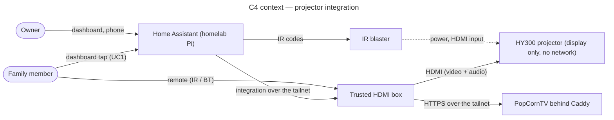

# Architecture — HY300 projector integration

Conception dossier of the `projector-integration` epic (#1): how a HY300-branded projector becomes a Home Assistant device showing PopCornTV, with the projector itself kept off every network. Source plan: `docs/research/2026-11-06-framing-and-plan.md` (revision 6: one self-review and six adversarial rounds, owner-validated on 2026-11-06; from that validation the ADRs under `decisions/` are authoritative and the plan is frozen as the record).

## Method

Hybrid UP + ICONIX (ADR-0002): UP phases frame the project (Inception = framing session, Elaboration = v0.1 reconnaissance, which retires the hardware unknowns first; Construction = v0.2–v0.3; Transition = v1.0); the per-use-case path use case text → sequence diagram → components is the design activity inside each milestone. Proportional: no class diagram (no domain model beyond four physical devices), no data-flow diagram (the only personal data handled is the redaction list of NFR-2, covered by `specs/security-redaction.md`), no activity diagram (the runbooks are the procedures).

## Scope

In: the projector as a display, an IR blaster, a trusted HDMI box, Home Assistant entities and one scene, PopCornTV playback on the box, reconnaissance of the board (identification, read-only dump, IR codes, power states), reproducibility by a third party.
Out: flashing or modifying the projector firmware (v3 study only, ADR-0003), playback driven from the phone (v2), changes inside bb-homelab or PopCornTV (filed as issues in those repositories).

## Stakeholders and goals

| Stakeholder | Goal |
|---|---|
| Owner (maintainer of bb-homelab and PopCornTV) | HA control, homelab security intact, learning value |
| Family (two daughters, guests) | start a film with the remote only |
| HA automations | power and scene control with a reliable state |
| Third party reproducing the work | runbooks that work from the repository alone |

## C4 context

## How to read this folder

1. `specs/projector-integration-requirements.md` — REQ/NFR with acceptance criteria.
2. `diagrams/projector-integration/` — `01-use-case`, `02-sequence-movie-night`, `03-component`, `05-state-projector`, `08-deployment-home`.
3. `decisions/` — ADR-0001 to ADR-0005.
4. `specs/projector-integration-risks.md`, `specs/security-redaction.md`.
5. `runbooks/` — procedures a third party follows; `00-safety.md` first. Deviation from the `conception-naming` layout: runbooks live here because NFR-7 is realised by them and the matrix cites them; 00–05 exist, the v0.2/v0.3 runbooks come with their bricks.
6. `traceability-matrix.md`, `glossary.md`.
7. `specs/projector-integration-roadmap.md` — the living order of the bricks (two tracks: hardware-free and on the bench), updated after every merged brick.
