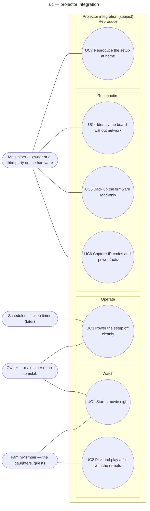

# Use case diagram — projector-integration — who wants what

> **Feature**: epic #1 — integrate the HY300 projector into Home Assistant and the homelab
> **Source specs**: `docs/architecture/specs/projector-integration-requirements.md`
> **Related ADRs**: ADR-0003, ADR-0005
> **Realises**: UC1–UC7 · **See also**: `02-sequence-movie-night.md`, `03-component.md`

## Context

Actor-initiated goals, grouped by domain (Watch, Operate, Reconnoitre, Reproduce) inside one subject. The Home Assistant / box / projector split is in `03-component.md`, not here. The HA scene itself is part of the subject, so it is not an actor; the sleep timer (a "later" feature) is the only non-human initiator.

## Diagram

## Use case texts (Cockburn, brief)

- **UC1 Start a movie night** — Primary actor: FamilyMember or Owner. Trigger: one tap on the HA dashboard or phone. Main success: (1) lights dim; (2) projector powered on by IR; (3) HDMI input selected by IR (skipped if the firmware remembers it); (4) box powered on; (5) PopCornTV launched; (6) notification sent; ≤ 60 s to HA `on` for the box (NFR-3). Extensions: 2a *only with the optional smart-plug power reading* — no draw rise after step 2 → one IR POWER retry, then notification (POWER is a toggle: without the reading there is no retry, only the notification of step 6 saying "projector state unknown"); 4a box unreachable → notification names the box.
- **UC2 Pick and play a film with the remote** — Primary actor: FamilyMember. Precondition: UC1 done, PopCornTV home on screen. Main success: (1) browse; (2) select; (3) play — ≤ 3 presses from the PopCornTV home to playback (REQ-4); 1080p direct play (NFR-4). Extensions: 1a login expired → fails REQ-4; the dedicated account's session must persist across reboots.
- **UC3 Power the setup off cleanly** — Primary actor: Owner, or Scheduler (sleep timer, later). Main success: (1) box powered off through its integration; (2) projector powered off by IR; (3) lights restored.
- **UC4 Identify the board without network** — Primary actor: Maintainer. Runbook 01. Postcondition: SoC vendor, Android version, OTG port recorded, redacted.
- **UC5 Back up the firmware read-only** — Primary actor: Maintainer. Runbook 02. Postcondition: verified dump stored encrypted or a recorded no-go; nothing written to the eMMC (NFR-6).
- **UC6 Capture IR codes and power facts** — Primary actor: Maintainer. Runbook 04. Postcondition: ADR-0005 frozen.
- **UC7 Reproduce the setup at home** — Primary actor: Maintainer (a third party). Precondition: the "what you bring" list of plan §6. Postcondition: zero blocking deviations (REQ-8).

## Notes

- "Receive a notification" is a trigger, not a goal: it belongs to UC1's main success scenario.
- The egress capture (runbook 03) and the cold-boot checks (runbook 05) are steps of UC5's OTG branch or of ADR-0003's review clause, not goals of their own.
