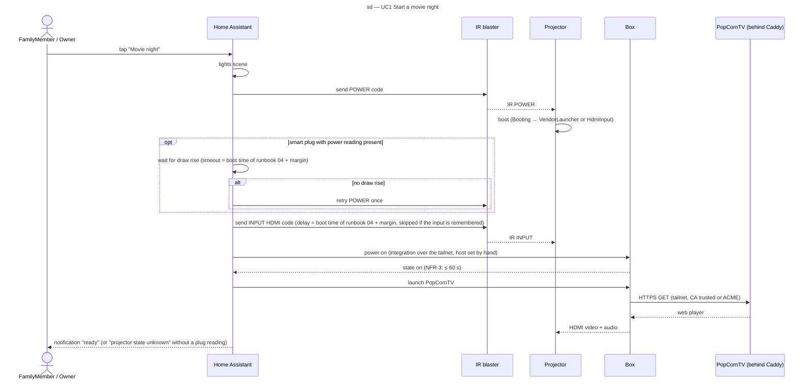

# Sequence diagram — projector-integration — movie night

> **Feature**: epic #1 — integrate the HY300 projector into Home Assistant and the homelab
> **Source specs**: `docs/architecture/specs/projector-integration-requirements.md` REQ-1, REQ-2, REQ-3, NFR-3
> **Related ADRs**: ADR-0003, ADR-0004, ADR-0005
> **Realises**: UC1 · **See also**: `03-component.md`, `05-state-projector.md`

## Context

The one-tap scene from a cold setup to PopCornTV on screen. Film selection (UC2) is out of scope: it happens on the box with the remote. HA has no feedback channel from the projector: the only optional feedback is a smart plug's power reading.

## Diagram

## Notes

- POWER is a toggle: a blind retry could switch a lit projector off, so the retry exists only with the plug reading (UC1 extension 2a).
- The box's integration ports and host are fixed by hand (ADR-0004: no mDNS over the tailnet).
- Volume is not part of the scene; it is set on the box's `media_player`.
