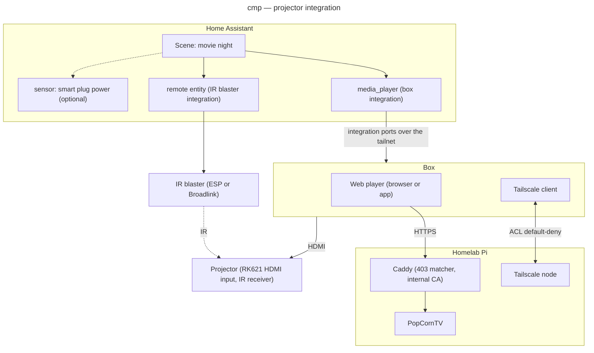

# Component diagram — projector-integration — structure and dependencies

> **Feature**: epic #1 — integrate the HY300 projector into Home Assistant and the homelab
> **Source specs**: `docs/architecture/specs/projector-integration-requirements.md`
> **Related ADRs**: ADR-0003, ADR-0004
> **Realises**: UC1, UC2, UC3 · **See also**: `08-deployment-home.md`

## Context

Logical parts and their dependencies. The rule that matters for security: **the projector has no outgoing dependency** — no arrow leaves it, so it can reach neither the network nor HA. Physical placement is in `08-deployment-home.md`.

## Diagram

## Notes

- Under strategy A (rejected, ADR-0003) an arrow would *leave* the projector (ADB/Tailscale link to the Pi and the tailnet); that outgoing dependency is the security point of C.
- The IR blaster integration depends on the hardware chosen in v0.2 (ESPHome `remote_transmitter` or Broadlink); the entity name stays `remote`. A cloud-bound blaster on the main LAN is risk R12.
- The smart plug power sensor is optional; it is the only feedback about the projector's state (UC1 extension 2a).
