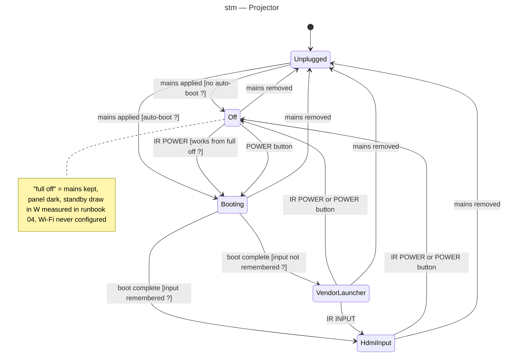

# State diagram — projector-integration — projector power lifecycle

> **Feature**: epic #1 — integrate the HY300 projector into Home Assistant and the homelab
> **Source specs**: `docs/architecture/specs/projector-integration-requirements.md` REQ-1, REQ-7
> **Related ADRs**: ADR-0005
> **Realises**: UC1, UC3, UC6 · **See also**: `02-sequence-movie-night.md`

## Context

What the projector can be in, as far as HA needs to know; guards marked `[... ?]` are the v0.1 facts of runbook 04 and decide the final shape of this machine. Transitions read `trigger [guard]`.

## Diagram

## Notes

- HA has no feedback channel from the projector (no network): its state is inferred from the last IR command and, in v0.2, optionally from a smart plug's power reading.
- A `Standby` state with Wi-Fi alive exists only under strategy A and is not modelled.
