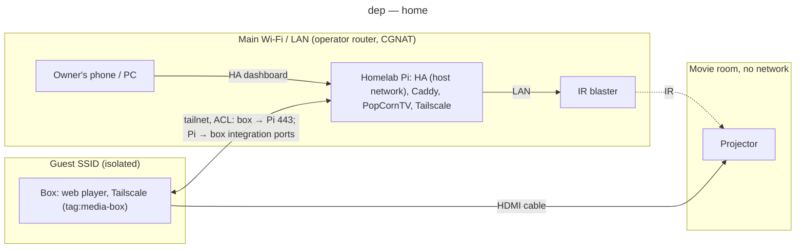

# Deployment diagram — projector-integration — home

> **Feature**: epic #1 — integrate the HY300 projector into Home Assistant and the homelab
> **Source specs**: `docs/architecture/specs/projector-integration-requirements.md` NFR-1
> **Related ADRs**: ADR-0003, ADR-0004
> **Realises**: NFR-1 · **See also**: `03-component.md`

## Context

Where each piece runs at home (D2: home first) and which network boundary each link crosses. No private hostname or address appears; the tiers are role aliases.

## Diagram

## Notes

- The box reaches nothing on the LAN (guest isolation) and nothing on the tailnet but Caddy's 443 and the ports HA opens toward it (ADR-0004).
- The nomadic case (D2, later) moves the box, blaster and projector together; the Pi stays home and the tailnet link remains for the box, but HA → blaster then needs a reachable path (blaster on the tailnet, or a local controller): to design when D2 "later" opens (`08b-deployment-away.md`; this file is then renamed `08a-deployment-home.md` per `conception-naming`).
- bb-homelab items that must exist first: ACL policy, Caddy 403 matcher, name resolution (split DNS or #28).
